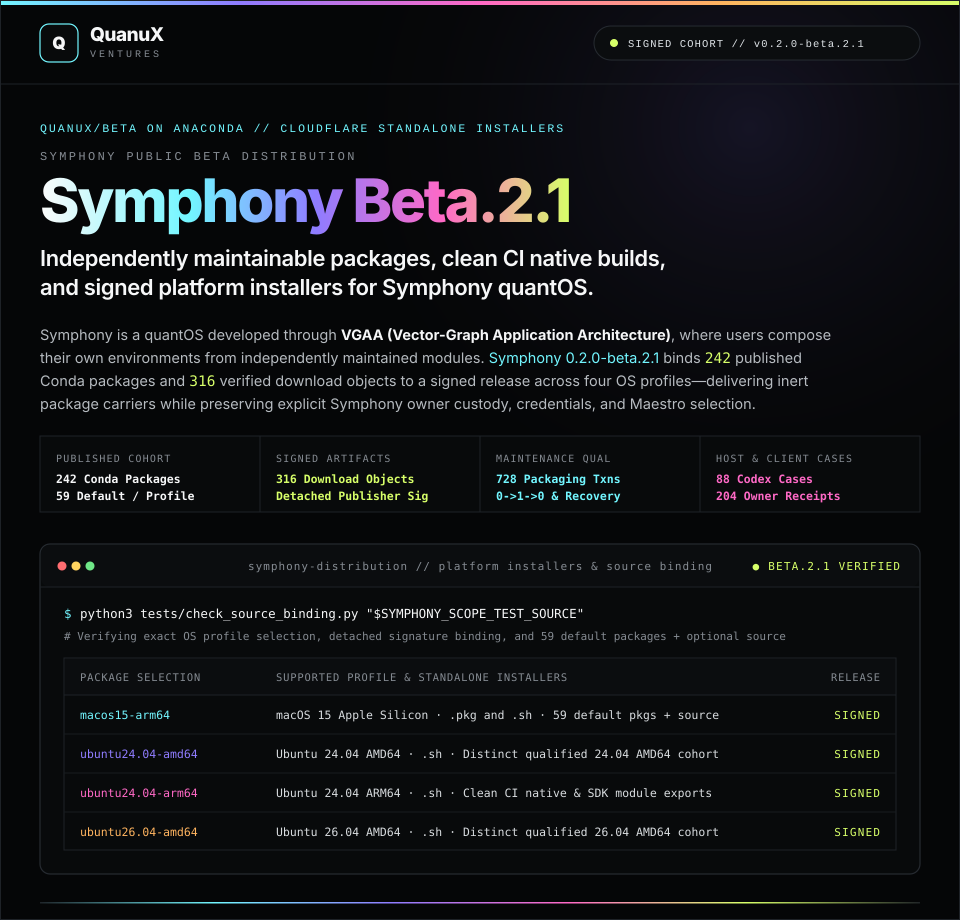
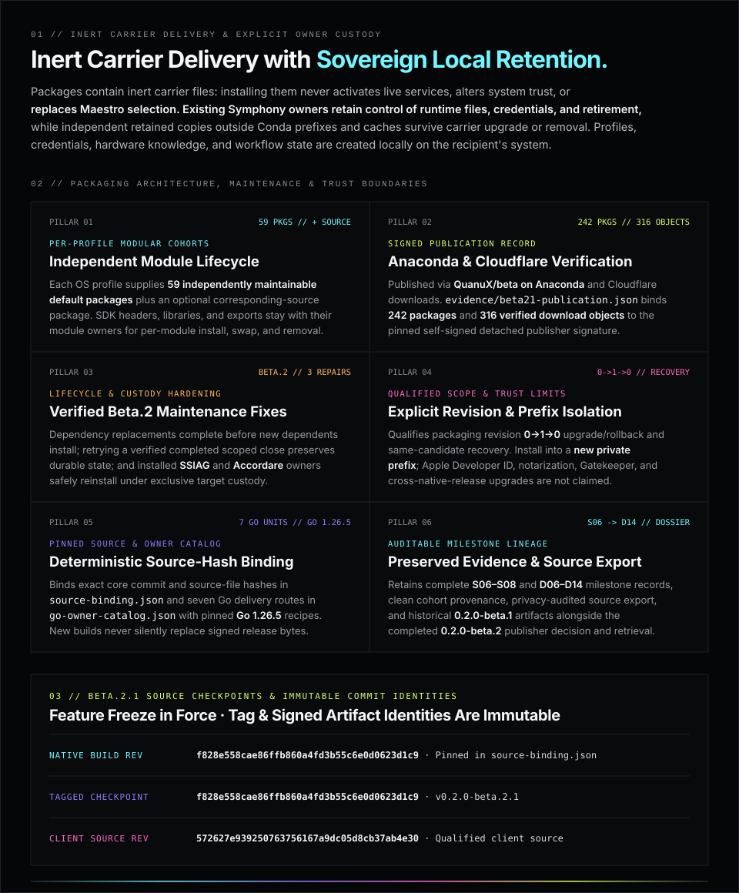
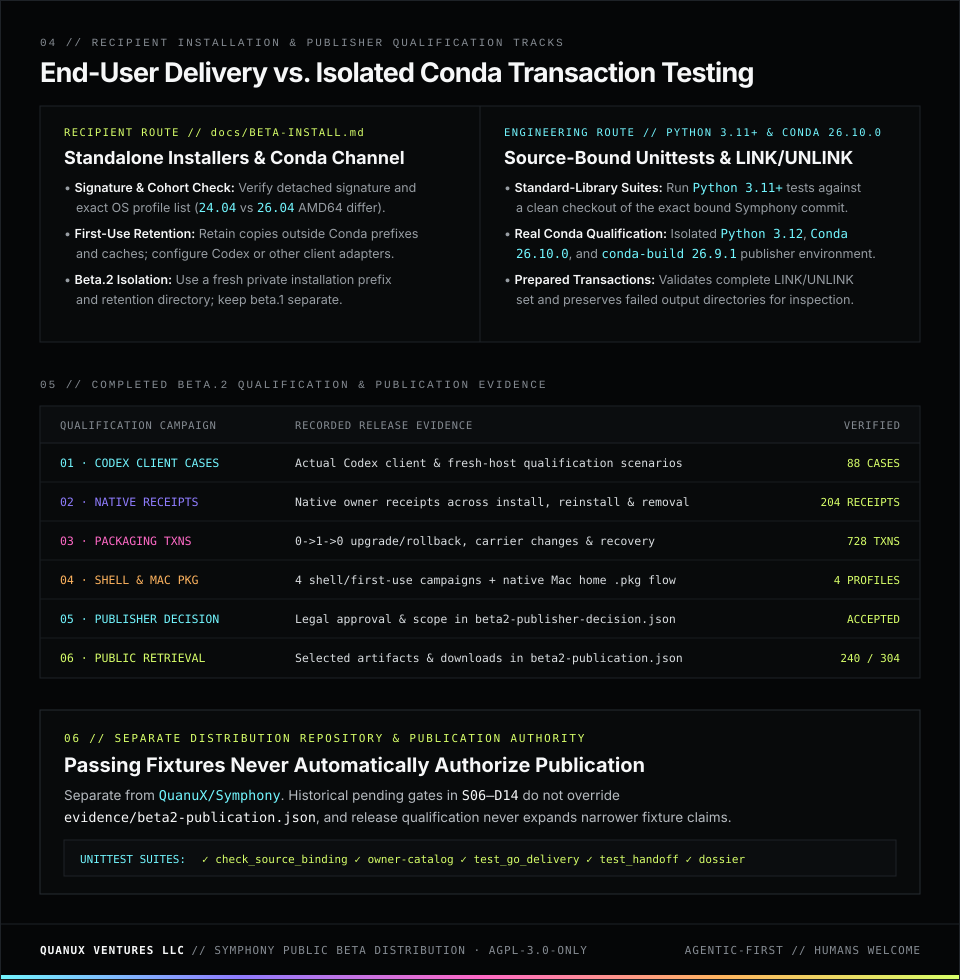
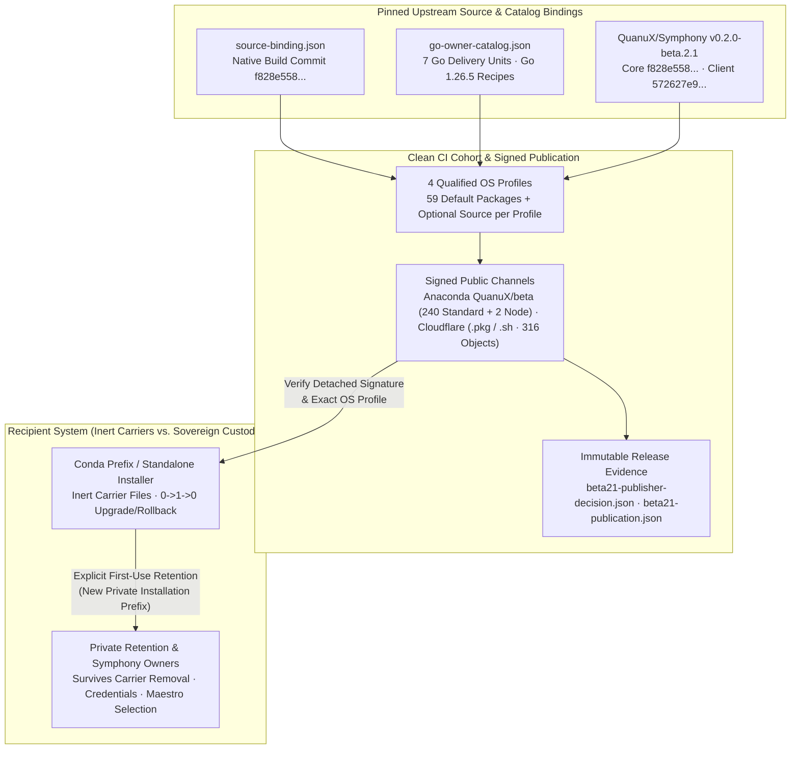

<div align="center">
  
  
  
</div>

<br />

<div align="center">

# Symphony Public Beta distribution

**Independently maintainable packages, clean CI native builds, and signed platform installers for Symphony quantOS.**

[**Install the latest beta**](https://quanux.org/downloads) · [**Release Page (`v0.2.0-beta.2.1`)**](https://github.com/QuanuX/symphony-distribution/releases/tag/v0.2.0-beta.2.1) · [**Installation & Verification Guide**](docs/BETA21-INSTALL.md) · [**Publication Record**](evidence/beta21-publication.json) · [**Publisher Decision**](evidence/beta21-publisher-decision.json) · [**Symphony Core**](https://github.com/QuanuX/Symphony)

</div>

Symphony is a quantOS developed through **VGAA (Vector-Graph Application Architecture)**. Users compose their own environments from independently maintained modules.

> [!IMPORTANT]
> Symphony **0.2.0-beta.2.1** is published through **QuanuX/beta on Anaconda** and Cloudflare downloads. The [publication record](evidence/beta21-publication.json) binds **240 standard Anaconda records**, **two optional node packages** and **316 verified download objects** to the signed release.

---

`00 // DELIVERY & CUSTODY TOPOLOGY`
## Distribution & Custody Topology



---

`01 // SUPPORTED PROFILES & INERT CARRIERS`
## Install the published beta

[Install the latest beta](https://quanux.org/downloads) with one command. Run it as your normal user. It selects your platform, verifies the publisher's signature and installs all 59 default packages, the `qxctl` command and the Codex client under `~/symphony-0.2.0-beta.2.1/`.

The installer needs Python 3.11 or later, curl, OpenSSL and Bash. Check your interpreter with `python3 --version`. If your Mac has an older Python or no interpreter, install a current stable version from [Python for macOS](https://www.python.org/downloads/macos/) and open a new terminal.

| Supported profile | Standalone installers | Package selection |
| :--- | :--- | :--- |
| **macOS 15 Apple Silicon** | `.pkg` and `.sh` | `macos15-arm64` |
| **Ubuntu 24.04 AMD64** | `.sh` | `ubuntu24.04-amd64` |
| **Ubuntu 24.04 ARM64** | `.sh` | `ubuntu24.04-arm64` |
| **Ubuntu 26.04 AMD64** | `.sh` | `ubuntu26.04-amd64` |

The [optional Linux node keyring](https://quanux.org/downloads#node-keyring) has separate Debian and Anaconda downloads for Ubuntu 26.04 on AMD64 and ARM64.

Each profile supplies 59 independently maintainable default packages and a separate optional corresponding-source package. SDK headers, libraries and exports stay with their module owners. Native and SDK bytes come from the selected clean CI builds; user profiles, credentials, hardware knowledge and workflow state are created on the recipient's system.

For a manual install or an existing Conda environment, follow the [installation and verification guide](docs/BETA21-INSTALL.md). It covers signature and profile verification, first-use retention, Codex setup, and per-module install, change, swap and removal. The two AMD64 Linux cohorts share a Conda subdirectory and require different builds.

> [!NOTE]
> Packages contain inert carrier files. Existing Symphony owners retain control of runtime files, credentials, process retirement and application selection; Maestro's selection is separate from package delivery. Independent retained copies outside Conda prefixes and caches survive carrier upgrade or removal. Installing packages does not activate services or select application modules.

---

`02 // RELEASE QUALIFICATION & PUBLISHER SIGNATURE`
## Qualified scope and trust

The historical beta.2 qualification included 88 actual Codex cases, 204 native owner receipts, 728 packaging maintenance transactions, four shell/first-use campaigns, and installation/removal of the exact native Mac home installer. The [beta.2 publisher decision](evidence/beta2-publisher-decision.json) and [beta.2 qualification record](evidence/beta2-publication.json) preserve those results.

This beta uses a pinned, self-signed detached publisher signature. Apple Developer ID, notarization, Gatekeeper acceptance and separate human-reviewer independence are not claimed. Packaging revision **0→1→0** upgrade/rollback, independent carrier changes and same-candidate recovery are qualified. Transitions between distinct native releases remain outside this initial beta. Unsupported ownership, uncertain effects and unexamined live consumers retain their existing refusal and recovery boundaries.

The feature freeze remains in force. Integration into `main` consolidates the reviewed release fixes and documentation; it does not add features or alter the published release. The tag and signed artifact identities are immutable. Later builds or documentation commits do not replace the selected release bytes. The [downloads page](https://quanux.org/downloads) lists the full installers and optional node packages.

---

`03 // LIFECYCLE REPAIRS & IMMUTABLE COMMITS`
## Beta.2 maintenance fixes and source checkpoint

Beta.2 includes the three lifecycle repairs: dependency replacements complete before their new dependents are installed; retrying a verified completed scoped close preserves durable state; installed SSIAG and Accordare owners can safely reinstall under exclusive target custody. Existing ownership, active-use and uncertain-outcome protections continue to apply.

Native binaries retain source commit `bae2e817120467561ae051c1b08cf61be3436bac`. Symphony's `v0.2.0-beta.2` tag captures the merged source checkpoint `8a6889597eef3d2713f48bf6962456f989188e18`; only README text differs from the native build revision. The unchanged original client source remains `572627e939250763756167a9dc05d8cb37ab4e30`.

> [!IMPORTANT]
> Use a new private installation prefix and retention directory for beta.2. An in-place native upgrade or rollback between beta.1 and beta.2 is not qualified. The [0.2.0-beta.1 release](https://github.com/QuanuX/symphony-distribution/releases/tag/v0.2.0-beta.1), its signatures, downloads and historical qualification records remain available for their original bytes. The [release evidence](evidence/beta2-publication.json) binds beta.2's completed qualification and freshly retrieved public downloads.

---

`04 // SOURCE BINDINGS, GUIDES & TEST SUITES`
## Engineering and maintenance

This repository is separate from [Symphony core](https://github.com/QuanuX/Symphony). The selected native build's exact core commit and source-file hashes remain in [source-binding.json](source-binding.json); the seven Go delivery routes remain in [go-owner-catalog.json](go-owner-catalog.json). Builds must match these bindings and the pinned Go 1.26.5 recipes, even after their source branches merge to main. A passing fixture or a new build is not automatic publication authority.

| Area | Guide |
| :--- | :--- |
| **End-user installation and independent modules** | [Beta installation](docs/BETA21-INSTALL.md) |
| **Retained binaries and explicit first use** | [Retention](delivery/README.md) |
| **Scoped native proposals and uncertain effects** | [Lifecycle](lifecycle/README.md), [recovery](docs/RECOVERY.md) |
| **Clean native/SDK builds** | [Build cohort](build-cohort/README.md) |
| **Source export and privacy** | [Source preparation](source-export/README.md) |
| **Installer assembly and signing** | [Installer tools](installer_assembly/README.md) |
| **Exact signed publication and retrieval** | [Channel tools](channel/README.md) |
| **Fault, platform and SDK qualification** | [Qualification](qualification/README.md) |
| **Preserved requirements and original acceptance mapping** | [Dossier](dossier/README.md) |

For focused standard-library tests, use Python 3.11 or later and a clean checkout of the exact bound core commit:

```sh
export SYMPHONY_SCOPE_TEST_SOURCE=/absolute/core-checkout
python3 tests/check_source_binding.py "$SYMPHONY_SCOPE_TEST_SOURCE"
python3 -m unittest discover -s owner-catalog -p 'test_*.py'
python3 -m unittest discover -s lifecycle -p 'test_go_delivery.py'
python3 -m unittest discover -s lifecycle -p 'test_handoff.py'
```

Real Conda qualification uses an isolated publisher environment with Python 3.12, Conda 26.10.0 and conda-build 26.9.1. Choose fresh output directories and preserve failed attempts for inspection. The adapter validates the complete LINK/UNLINK set and executes the same prepared transaction in its private attempt; it does not claim exclusion against unrelated clients of existing environments.

---

`05 // MILESTONE EVIDENCE ARCHIVE (S06 – D14)`
## Historical milestone records

These records preserve the evidence and unresolved inputs observed at each milestone. Their historical pending gates do not override the current [publication result](evidence/beta21-publication.json), and completed release qualification does not expand their narrower fixture claims.

| Milestone | Retained record |
| :--- | :--- |
| **S06 guarded Conda journeys** | [Results](evidence/RESULTS.md), [preparation commands](docs/DELIVERY.md) |
| **S07 fault and concurrency fixtures** | [Campaign and acceptance mapping](qualification/README.md) |
| **S08 dossier and source delivery** | [Results](evidence/S08-RESULTS.md), [dossier](dossier/README.md) |
| **D06 clean native and SDK cohort** | [Results](evidence/D06-RESULTS.md), [build guide](docs/D06-CLEAN-COHORT.md) |
| **D07 client packaging** | [Results](evidence/D07-RESULTS.md), [handoff](docs/D07-CLIENT-GATE.md) |
| **D08 embedded-source repair and review installers** | [Results](evidence/D08-RESULTS.md), [handoff](docs/D08-INSTALLER-ASSEMBLY.md) |
| **D09 review delivery** | [Status](docs/D09-STATUS.md), [acceptance packet](docs/D09-ACCEPTANCE.md) |
| **D10 wrapper qualification** | [Status](docs/D10-STATUS.md), [wrapper provenance](docs/D10-PRIMARY-REWRAP.md) |
| **D11 artifact admission** | [Status](docs/D11-STATUS.md), [selection rules](docs/D11-ARTIFACT-SELECTION.md) |
| **D12 retained native recovery** | [Handoff](docs/D12-NATIVE-RECOVERY.md) |
| **D13 fresh-host/client qualification** | [Handoff](docs/D13-FRESH-HOST-CLIENT.md) |
| **D14 beta assembly and publication** | [Beta.2 qualification and publication](evidence/beta2-publication.json), [historical beta.1 hosted qualification](evidence/d14-beta-hosted-qualification.json) |

---

<div align="center">
  <sub><strong>QUANUX VENTURES LLC</strong> // <a href="https://quanux.org">QUANUX.ORG</a> · <a href="https://docs.quanux.org">DOCS.QUANUX.ORG</a> · <a href="https://github.com/QuanuX/Symphony">QUANUX SYMPHONY</a> // AGENTIC-FIRST · HUMANS WELCOME</sub>
</div>
